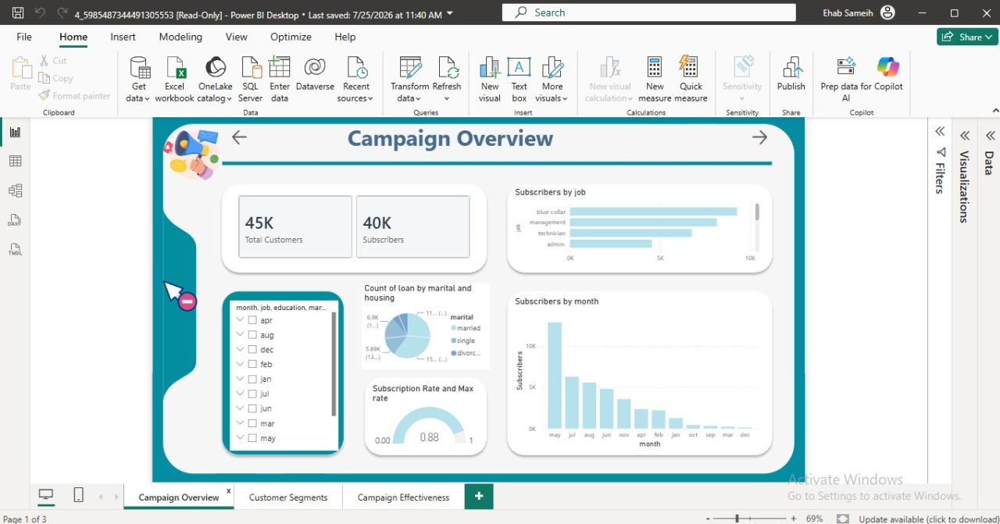
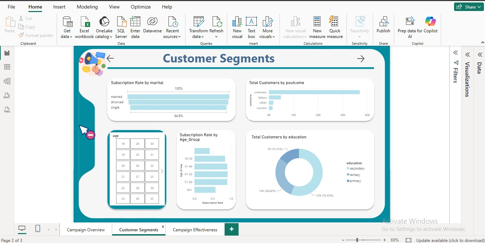
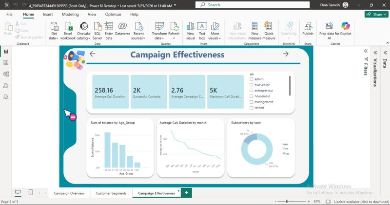

# Bank Marketing Analysis & Customer Behavior Dashboard

An end-to-end Data Analytics and Machine Learning project focused on analyzing bank marketing campaigns, understanding customer behavior, and predicting term deposit subscriptions.

The project combines Python-based data analysis, machine learning classification models, and an interactive Power BI dashboard.

## Project Overview

The goal of this project is to explore customer characteristics, identify patterns in marketing campaign performance, and understand the factors associated with term deposit subscriptions.

The project workflow includes data exploration, preprocessing, machine learning, and interactive data visualization.

## Project Objectives

- Explore customer demographics and financial characteristics.
- Analyze bank marketing campaign performance.
- Identify customer segments and behavioral patterns.
- Apply machine learning classification models.
- Evaluate model performance and compare results.
- Build an interactive Power BI dashboard.

## Dataset

The dataset contains bank customer and telemarketing campaign information.

It includes features related to:

- Customer demographics: age, job, marital status, and education.
- Financial information: balance, housing loan, and personal loan.
- Campaign details: contact type, month, call duration, and number of contacts.
- Target variable: term deposit subscription.

## Tools & Technologies

- **Python:** Data analysis and preprocessing.
- **Pandas & NumPy:** Data manipulation.
- **Matplotlib & Seaborn:** Data visualization.
- **Scikit-learn:** Machine learning.
- **Power BI:** Interactive dashboards and reporting.
- **Microsoft Excel:** Data handling.

## Project Workflow

### 1. Data Cleaning & Preprocessing
- Dataset inspection and understanding.
- Handling categorical unknown values.
- Duplicate and outlier checks.
- Feature engineering and encoding.

### 2. Exploratory Data Analysis (EDA)
- Customer demographic analysis.
- Subscription behavior analysis.
- Campaign performance exploration.
- Correlation and visualization analysis.

### 3. Machine Learning
Two classification models were developed and evaluated:

- Logistic Regression
- Random Forest Classifier

The models were compared using classification evaluation metrics.

### 4. Power BI Dashboard
The interactive dashboard contains three pages:

- Campaign Overview
- Customer Segments
- Campaign Effectiveness

## Dashboard Preview

### Campaign Overview

### Customer Segments

### Campaign Effectiveness

## Project Files

| File | Description |
|---|---|
| [Power BI Dashboard](bank-marketing-dashboard.pbix) | Interactive Power BI dashboard |
| [Python Notebook](notebooks/bank-marketing-analysis.ipynb) | Data analysis, preprocessing, and machine learning |
| [Cleaned Dataset](<bank_marketing_cleaned (1).csv>) | Dataset used in the project |

## Key Learning Outcomes

- Practical experience in data cleaning and preprocessing.
- Exploratory data analysis and data visualization.
- Building and evaluating classification models.
- Developing interactive dashboards using Power BI.
- Translating data analysis into meaningful business insights.

---

**Project Category:** Data Analytics | Machine Learning | Business Intelligence

**Tools:** Python | Pandas | Scikit-learn | Power BI | Excel
